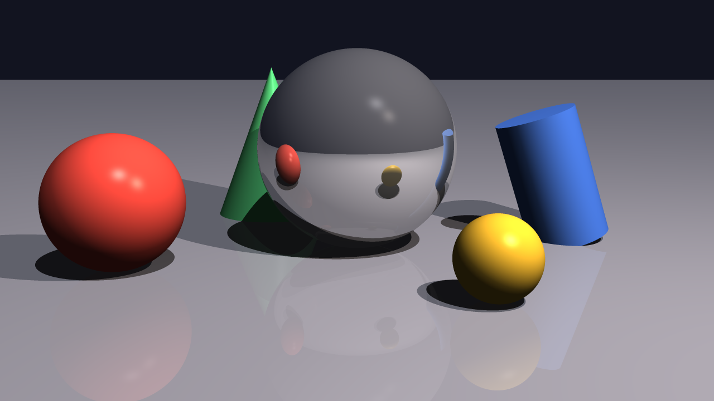

# Raytracer

A ray tracing renderer in C++20 that turns a scene description file into an image.



*`scenes/demo.cfg`, 1280x720 with 3x3 antialiasing: 0.28 s on 10 threads, 1.48 s on one.*

Started in 2023 as a team of three for an Epitech object-oriented programming project, where I wrote the scene parser and the object factory. The project was left unfinished; I picked it up and completed it on my own in 2026.

## Features

- **Primitives**: sphere, infinite plane, closed cylinder, cone with its base
- **Transformations**: translation and rotation of any primitive
- **Lights**: ambient, directional and point lights, with any color and intensity
- **Shading**: Phong model (diffuse and specular), cast shadows, recursive reflections
- **Antialiasing**: n x n supersampling per pixel
- **Multithreading**: rows are handed out to worker threads through an atomic counter
- **Output**: PPM or PNG, picked from the file extension (PNG encoder written on top of zlib)

## Build and run

Requires a C++20 compiler, [libconfig++](https://hyperrealm.github.io/libconfig/) and zlib.

```bash
brew install libconfig          # macOS
sudo apt install libconfig++-dev  # Debian / Ubuntu

make
./raytracer scenes/demo.cfg -o demo.png
```

Options: `-o` output file (default `output.ppm`), `-j` number of threads (default: all cores).

## Scene files

Scenes use the [libconfig](https://hyperrealm.github.io/libconfig/) format. Colors are 0-255, angles in degrees.

```
camera: {
    resolution = { width = 1280; height = 720; };
    position = { x = 0.0; y = 2.0; z = 9.0; };
    rotation = { x = -10.0; y = 0.0; z = 0.0; };
    fov = 55.0;
};

render: { antialiasing = 3; max_depth = 5; };

primitives: {
    spheres = (
        { position = { x = 0.0; y = 1.0; z = 0.0; }; radius = 1.0;
          color = { r = 230; g = 70; b = 60; };
          material = { reflection = 0.3; specular = 0.5; shininess = 60.0; }; }
    );
    planes = ( { color = { r = 150; g = 150; b = 165; }; } );
};

lights: {
    ambient = 0.1;
    point = ( { position = { x = 4.0; y = 6.0; z = 5.0; }; intensity = 0.8; } );
};
```

| Primitive | Fields | Local shape |
|---|---|---|
| `spheres` | `radius` | centered on the origin |
| `planes` | | the plane y = 0 |
| `cylinders` | `radius`, `height` | axis y, from y = 0 to y = height |
| `cones` | `radius`, `height` | base on y = 0, apex at y = height |

Every primitive also takes `position`, `rotation`, `color` and `material` (`reflection` 0-1, `specular`, `shininess`). Errors in a scene file are reported with their line number.

## Design

```
include/
├── math/          Vector3, Ray, Transform (rotation matrix and its inverse)
├── primitives/    IPrimitive interface, APrimitive base, Sphere, Plane, Cylinder, Cone
├── lights/        ILight interface, DirectionalLight, PointLight
├── Camera.hpp     primary rays from pixel coordinates
├── Scene.hpp      camera, objects, lights, render settings
├── Parser.hpp     libconfig scene file to Scene
├── ObjectFactory.hpp
└── Renderer.hpp   tracing, shading, threads, image output
```

- **Local space**: each primitive is defined around the origin. `APrimitive` moves the ray into the object's space with the inverse transform, the primitive solves a simple equation there (for example x² + z² = r² for a cylinder), and the normal is rotated back. Adding rotation to a shape costs nothing in its intersection code.
- **Factory**: the parser does not know the concrete primitive classes. It reads each list name (`spheres`, `cones`, ...) and asks `ObjectFactory`, which maps names to creation functions. A new primitive is one class plus one `registerPrimitive` call.
- **Shadows and reflections**: for each light, a shadow ray is cast towards it from the hit point, nudged along the normal to avoid hitting the surface itself. Reflective materials cast a mirrored ray and blend its color, up to `max_depth` bounces.

## Limits

- No refraction or transparency, no textures.
- Every object is tested against every ray: there is no acceleration structure (BVH), so large scenes get slow.
- Hard shadows only, since lights are points or directions.
